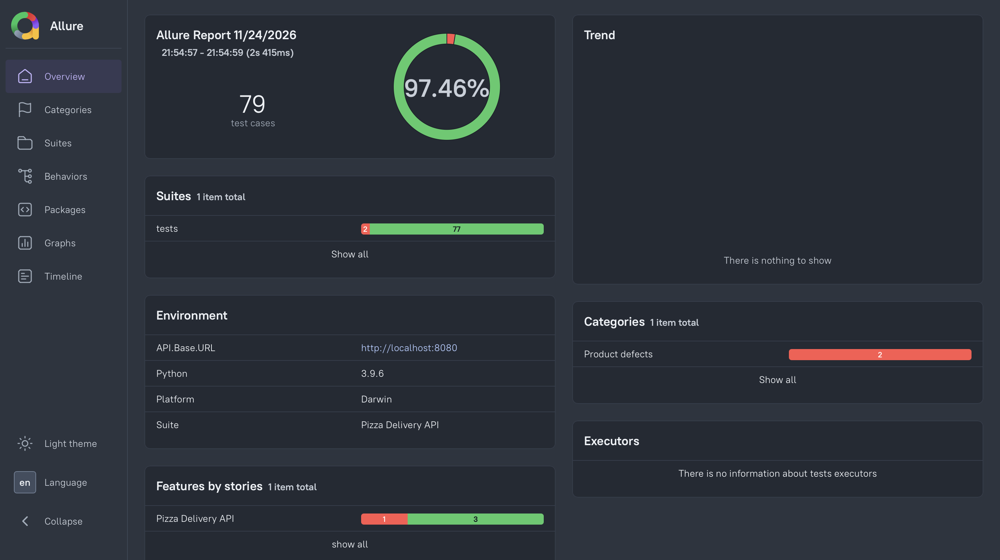

# Запуск тестов

Нужны Python 3.12 с pip и venv, запущенный Docker с Compose v2.
Для генерации отчёта установите Java 17 и
Allure CLI 2.33.0

### 1. Запустить приложение

Команды выполняются из корня репозитория `hw`. Тестируемое приложение находится
в [отдельном репозитории](https://github.com/NZRV-88/TestProject).
Скачайте его в соседний каталог и запустите backend с PostgreSQL:

```bash
git clone https://github.com/NZRV-88/TestProject.git ../pizza-app
docker compose -f ../pizza-app/docker-compose.yml up -d --build app
curl -i http://localhost:8080/orders
```

Дождитесь ответа `HTTP 200`. Нужны свободные порты `8080` и `5432`.

### 2. Установить зависимости и запустить тесты

Из корня репозитория `hw`:

```bash
cd api-tests
python3 -m venv .venv
source .venv/bin/activate
python -m pip install -r requirements.txt
python -m pytest -v
```

По умолчанию тесты обращаются к `http://localhost:8080`, тайм-аут запроса —
10 секунд. Для другого адреса задайте `API_BASE_URL`, для другого тайм-аута —
`API_TIMEOUT` перед запуском. Пример:

```bash
API_BASE_URL=http://localhost:18080 API_TIMEOUT=15 python -m pytest -v
```

### 3. Получить Allure-отчёт

После завершения тестов выполните из `api-tests/`:

```bash
allure generate allure-results --single-file --clean -o report
```

Откройте `report/index.html` в браузере. Генерируйте отчёт отдельной командой,
даже если тесты завершились с падениями: результаты сохраняются и для них.


