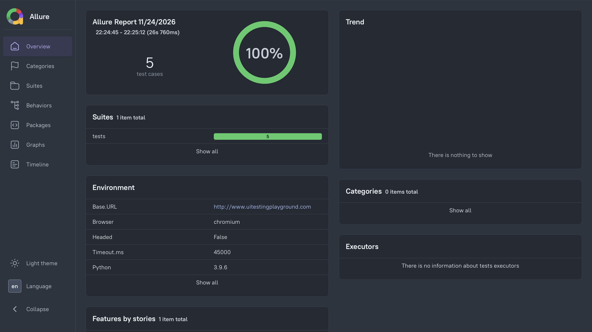

# Запуск web-тестов

Нужны Python 3.9+ с pip и venv и доступ к
[UI Testing Playground](http://www.uitestingplayground.com).
Для генерации отчёта установите Java 17 и
Allure CLI 2.33.0

### 1. Установить зависимости и запустить тесты

```bash
cd web-tests
python3 -m venv .venv
source .venv/bin/activate
python -m pip install -r requirements.txt
python -m playwright install chromium
python -m pytest
```

### 2. Дополнительные параметры запуска

Все команды выполняются из `web-tests/`

```bash
python -m pytest --headed
python -m pytest -m text_input
python -m pytest -m ajax
python -m pytest -m dynamic_table
python -m pytest --base-url http://www.uitestingplayground.com --timeout-ms 45000
```

По умолчанию используется Chromium без окна браузера, тайм-аут 30 секунд.
`--base-url` задаётся без `/home`. Для другого браузера сначала установите его:

```bash
python -m playwright install firefox
python -m pytest --browser firefox
```

### 3. Получить Allure-отчёт

После завершения тестов выполните из `web-tests/`:

```bash
allure generate allure-results --single-file --clean -o report
```

Откройте `report/index.html` в браузере.


